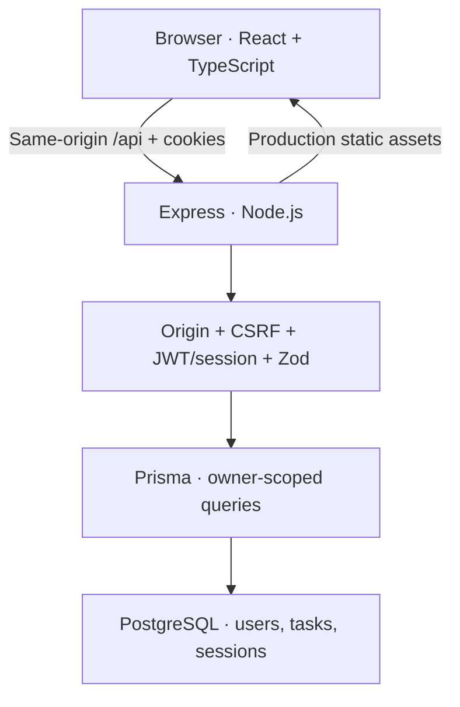

# TaskFlow

A focused, responsive task manager built with a genuine **Node.js + Express API**, **React + TypeScript**, and **PostgreSQL**. TaskFlow helps an individual plan work, track priorities, and see progress without a cluttered interface.

Built by **Ambuj Kumar**, B.Tech CSE (Data Science), graduating May 2027, as a practical full-stack portfolio project.

**Deployment status:** prepared for Render; no public deployment or GitHub URL is claimed until authorized and verified. See [verification](docs/VERIFICATION.md).

## What works

- Register, sign in, retain a session across reloads, and sign out with immediate server-side session revocation.
- Create, read, edit, complete/reopen and delete your own tasks.
- Add descriptions, priorities, status and optional due dates.
- Search by title, filter by status/priority, and page through results.
- See live database-backed total, to-do, in-progress and completed counts.
- Use desktop or mobile navigation, keyboard-friendly native dialogs and accessible labeled forms.
- Receive loading, empty, validation, success and error feedback.

There are no shared public demo credentials. A private, opt-in seed creates a realistic workspace without resetting an existing account.

## Architecture



Development uses Vite's `/api` proxy. Production serves the built React application from Express, so one web service and one database are sufficient. No cross-origin cookie setup or external API is required.

| Area           | Choice                                                                          |
| -------------- | ------------------------------------------------------------------------------- |
| Runtime        | Node.js 26 LTS; version pinned in `.node-version`                               |
| API            | Express 5, TypeScript, Zod, Helmet, express-rate-limit                          |
| Authentication | bcrypt cost 12, eight-hour JWT, HttpOnly cookies, database-backed revocation    |
| Database       | PostgreSQL 17, Prisma 7.10.1 and `@prisma/adapter-pg`, versioned SQL migrations |
| Frontend       | React 19, Vite 8, TypeScript, Tailwind CSS 4, Lucide icons                      |
| Verification   | Vitest, Supertest, React Testing Library, Playwright                            |
| Deployment     | Render web service serving API + SPA, Render Postgres                           |

## Local setup on Windows 11

Prerequisites: the Node.js version in `.node-version`, npm, Git and either Docker Desktop with its Linux engine running or a locally installed PostgreSQL 17 server. Docker is only a local convenience; production uses managed PostgreSQL.

From the repository root in PowerShell:

```powershell
npm ci
Copy-Item .env.example .env
node -e "console.log(require('crypto').randomBytes(48).toString('hex'))"
```

Paste the generated value into `JWT_SECRET` in your local `.env`. Do not post it in chat or commit it. Keep `APP_ORIGIN=http://localhost:5173`. `.env` is loaded from the repository root by the server and Prisma config.

```powershell
docker compose up -d
npm run db:generate
npm run db:deploy
npm run dev
```

Open **http://localhost:5173** and create your account. The API runs on port 3001. Local PostgreSQL is bound only to `127.0.0.1:5434`. The Compose credentials are disposable development defaults; never use them on a public server.

If you use existing PostgreSQL, create **two new empty databases**, `taskflow` and `taskflow_test`, with a dedicated local role; update both connection URLs accordingly. The application requires PostgreSQL and never silently falls back to SQLite.

If the Compose volume already existed before the test initialization script, create `taskflow_test` with PostgreSQL tooling. Avoid `docker compose down -v` unless you intentionally want to erase local data.

### Optional private seed

Set `SEED_EMAIL`, `SEED_PASSWORD` (14–72 UTF-8 bytes) and optionally `SEED_NAME` in your private `.env`, then run:

```powershell
npm run db:seed
```

The script creates eight realistic sample tasks with dates relative to the day it runs. If the email already exists, it makes no changes. Never publish seed credentials. Visitors should register their own isolated account.

## Environment variables

| Variable                                   | Purpose                                                                                                    |
| ------------------------------------------ | ---------------------------------------------------------------------------------------------------------- |
| `NODE_ENV`                                 | `development`, `test`, or `production`                                                                     |
| `PORT`                                     | API listen port; defaults to 3001; Render injects its port                                                 |
| `APP_ORIGIN`                               | Exact public frontend origin without a trailing path; HTTPS required in production                         |
| `DATABASE_URL`                             | PostgreSQL application connection string                                                                   |
| `JWT_SECRET`                               | Random secret of at least 32 characters (Render generates a 256-bit secret); rotate to invalidate all JWTs |
| `TEST_DATABASE_URL`                        | Separate disposable PostgreSQL database ending in `_test`; required for API tests                          |
| `SEED_EMAIL`, `SEED_PASSWORD`, `SEED_NAME` | Optional private seed configuration                                                                        |
| `E2E_BASE_URL`                             | Optional running application URL for explicit Playwright smoke tests                                       |

## Tests and builds

```powershell
npm run verify
# Or run checks individually:
npm run db:generate
npm run lint
npm run typecheck
npm test
npm run build
npm audit --omit=dev
```

API integration tests apply committed migrations **only to `TEST_DATABASE_URL`**. Configuration refuses a URL equal to the application URL or a database whose name does not end in `_test`. Tests create uniquely named accounts and remove only those accounts; task and session cleanup cascades through foreign keys. Frontend tests exercise actual form entry and error handling. They do not replace real API integration tests.

The root test command generates Prisma and builds the client first, so production-static tests also work on a clean checkout. npm run verify runs lint, typecheck, tests, build and the runtime audit in sequence. See [phase checkpoints](docs/CHECKPOINTS.md).

With the app running, install a local Chromium browser once and run:

```powershell
npx playwright install chromium
npm run test:e2e
```

Playwright includes axe-core accessibility scans and covers desktop (1440px) and mobile (390px), registration, session persistence, task creation/editing/completion/deletion, search, dashboard progress, and sign-out/sign-in. It creates unique test accounts and deletes their tasks; accounts remain until the test database is removed. Run it against public deployment only after explicit authorization.

For production locally, build first, set `NODE_ENV=production`, and provide HTTPS with the correct `APP_ORIGIN`. Production cookies intentionally do not work over ordinary insecure HTTP. Do not weaken cookie security to make a local production preview sign-in work.

## Deployment on Render

**Creating the GitHub repository, pushing and applying the Render blueprint require the owner's authorization.** No payment is required by this configuration; do not choose a paid plan as an automatic fallback.

1. Create a GitHub repository named `taskflow`, select the desired visibility, and push the reviewed local `main` branch. Never include `.env`, `.local`, database files or credentials.
2. In Render, choose **New → Blueprint** and connect that repository. Review `render.yaml`: one free Node web service and one free PostgreSQL 17 database, both in Oregon. Use new TaskFlow resources; do not replace existing projects.
3. Set `APP_ORIGIN` to the web service's actual HTTPS origin. Do not guess the final subdomain. The blueprint generates `JWT_SECRET` and injects the database's internal connection string automatically. Render may need an initial service creation followed by this origin update and a manual deploy.
4. Build command: `npm ci --include=dev && npm run build`. Start command: `npm run start:render`. This runs `prisma migrate deploy` before starting Express; migration failures prevent startup. A single free instance is intentional. The health endpoint checks the actual database.
5. Confirm `/api/health` returns `200` and `{"status":"ok","database":"connected"}`. Open the root URL and complete the checklist in [VERIFICATION.md](docs/VERIFICATION.md).
6. Only after those checks pass, add the **actual verified** public URL and repository URL here and in your application.

If Blueprint creation is unavailable, manually create the same free PostgreSQL database and Node web service. Set `NODE_VERSION=26.13.1`, `NODE_ENV=production`, `APP_ORIGIN`, a privately generated `JWT_SECRET`, and the database's **internal** `DATABASE_URL`. Use the same build/start/health commands and disable automatic deployments until you want them.

Render free web services sleep after inactivity; the first request can be slow. Free PostgreSQL expires after 30 days and only one free database can be active per workspace. Check availability before creating resources, record expiration, and export data before expiry. This is portfolio/demo hosting, not durable production infrastructure. See [Render free-tier documentation](https://render.com/docs/free).

## Security design and practical limits

- Exact-origin, JSON-only mutations plus an HttpOnly double-submit CSRF cookie and custom token header.
- `Secure`, `HttpOnly`, `SameSite=Lax`, host-only authentication and CSRF cookies in production.
- JWT signature, algorithm, issuer, audience and expiration checks plus a PostgreSQL session lookup on every authenticated request.
- Every task operation is owner-scoped, including updates and deletes. User IDs are never accepted from task input.
- Password limits account for bcrypt's 72-byte behavior. Hashes, passwords, cookies, tokens and request bodies never enter application logs.
- Strict mutation validation, 16 KiB body limits, HTTP security headers/CSP, generic public server errors, and fail-fast environment checks.
- Same-origin deployment; no wildcard CORS. React renders user text without HTML injection.
- Parameterized Prisma queries, email uniqueness, foreign keys and indexes by user + status/priority/creation date.
- Graceful HTTP shutdown and database disconnect, migration-first startup, readiness health checks.

This MVP has no email verification or password reset, no organizations/team sharing, and no notifications. Rate limits are in memory and reset on restart; multi-instance deployment requires a shared limit store. Proxy trust is set for one Render proxy hop and must be revisited for another hosting topology. Concurrent edits use last-write-wins. Substring search is adequate for portfolio scale; measure before adding PostgreSQL trigram indexes. Registration can reveal that an email is unavailable; login errors are generic. Expired sessions are cleaned for the user on the next login.

Build/test tools may have advisories independently of runtime packages. See the actual audit record in [VERIFICATION.md](docs/VERIFICATION.md); never use `npm audit fix --force` blindly. Only Express and static built assets run publicly; never expose the Vite dev server to the internet.

## Project map

```text
client/src/           React pages, components, API client, styling and UI tests
server/src/           Express API, validation, configuration and database client
server/prisma/        Schema, committed migrations and opt-in private seed
server/tests/         Real PostgreSQL integration tests
e2e/                  Browser smoke tests for desktop and mobile
docs/API.md           API contract, CSRF flow, statuses and examples
docs/INTERVIEW.md     Architecture explanation and interview preparation
docs/VERIFICATION.md  Executed checks and deployment status
render.yaml           Reviewed free-tier deployment configuration
compose.yaml          Local PostgreSQL with separate test database
```

## Screenshots

Use an account containing only synthetic tasks. Capture the overview at 1440×1000 and 390×844, plus the create-task dialog and sign-in screen. Place approved captures in `docs/screenshots/` and link them here after reviewing them for personal information. Do not include credentials, database URLs or tokens.

For API details see [API.md](docs/API.md). For the learning walkthrough and likely interview questions see [INTERVIEW.md](docs/INTERVIEW.md).
